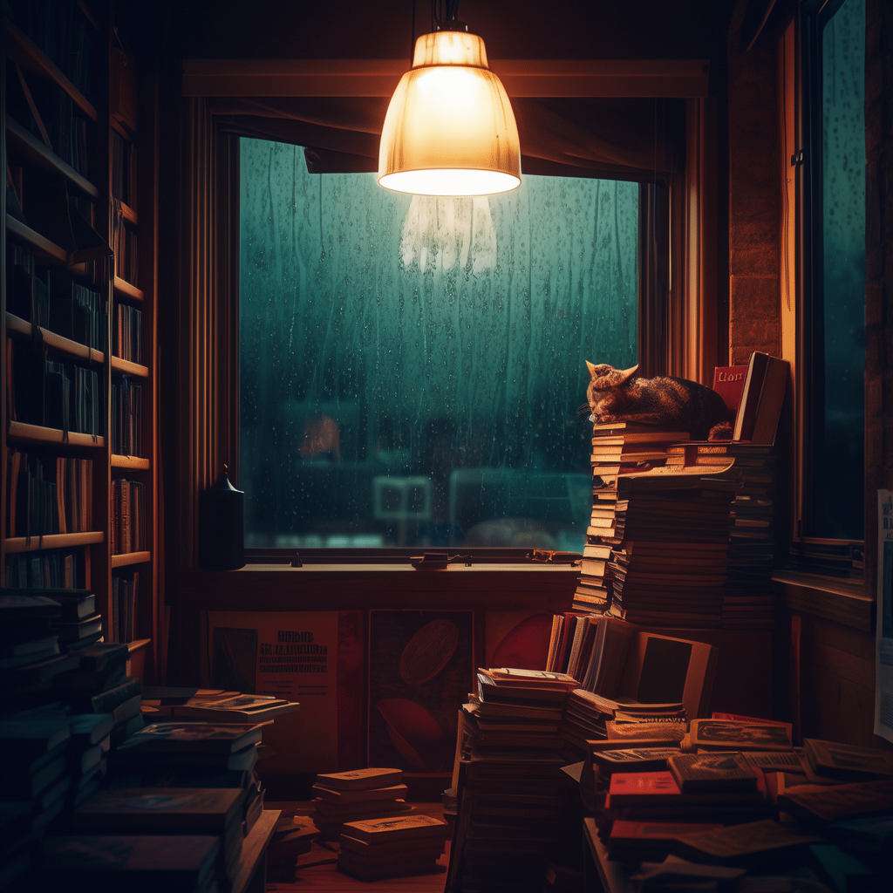
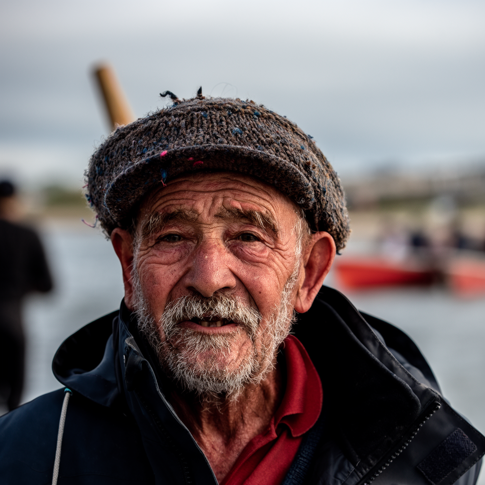
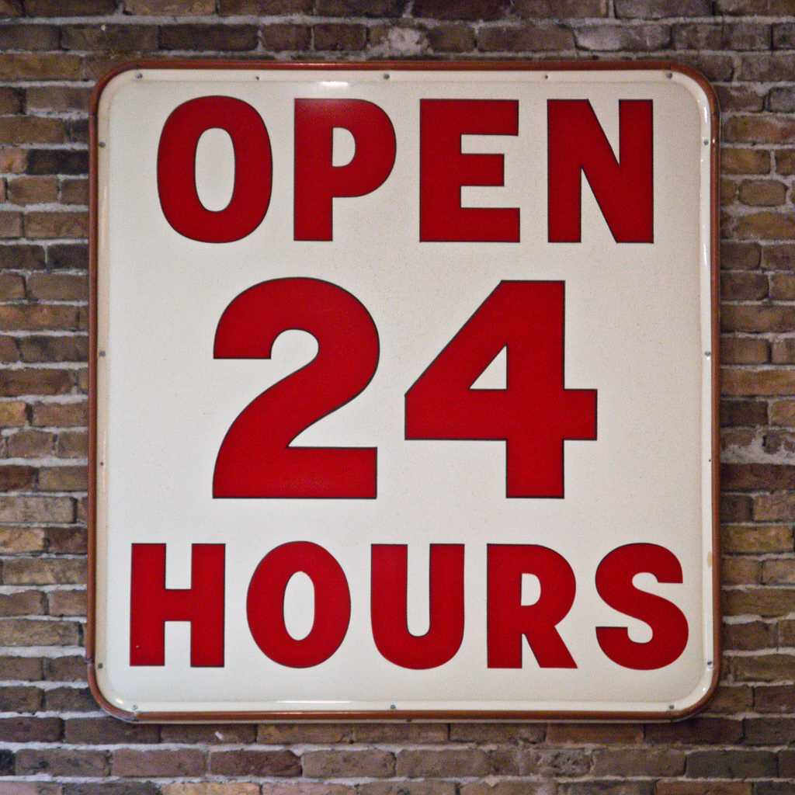
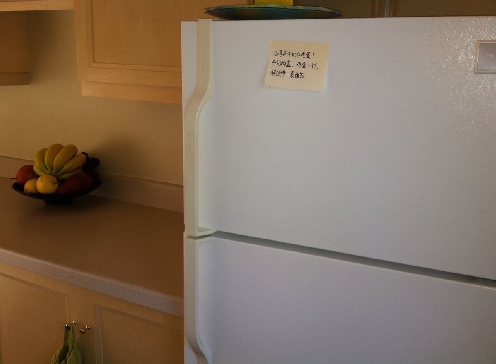
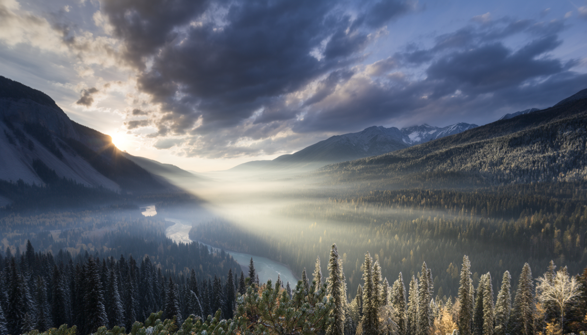

# Gallery

Five pictures made by this recipe's `python3 -m mac generate` on one M5 Ultra from checkpoint
revision 85975793, at the card's defaults (50 steps, guidance 3, the empty negative prompt skipping block 22). Nothing was
picked or retouched: each is the one picture its prompt and seed gave.

They were made on engine 7beb5243, which encodes the prompt on Metal as well as running the transformer, and made again
on the pinned 6f05bcd9 (the same code rebased) with byte-identical results. Times are not given here: the runs shared the Mac with other builds.
The recipe's measured speeds are in the [README](../../README.md).

| picture | size | seed |
|---|---|---|
| [1-bookshop.png](1-bookshop.png) | 1024 x 1024 | 42 |
| [2-portrait.png](2-portrait.png) | 1024 x 1024 | 7 |
| [3-sign.png](3-sign.png) | 1024 x 1024 | 42 |
| [4-fridge-zh.png](4-fridge-zh.png) | 1200 x 880 | 7 |
| [5-valley.png](5-valley.png) | 1344 x 768 | 3 |

With the prompt encoded in torch instead (engine 772283b6), the same prompts and seeds give pictures that differ from
these by 22.96 dB PSNR (the sign) to 47.05 dB (the valley): bookshop 32.35, portrait 37.33, sticky note 26.64.

## Prompts

1. A cozy bookshop interior on a rainy evening, warm lamplight, a cat sleeping on a stack of old books, rain streaking
   the window
2. Close-up portrait of an elderly fisherman with a weathered face and a knitted wool cap, soft overcast light, shallow
   depth of field, photograph
3. A vintage enamel shop sign that reads "OPEN 24 HOURS" in bold red letters, mounted on a brick wall
4. The model card's prompt, [cases/fridge-zh.txt](../../cases/fridge-zh.txt)
5. A wide mountain valley at sunrise, mist over a winding river, pine forests, dramatic clouds, landscape photograph

