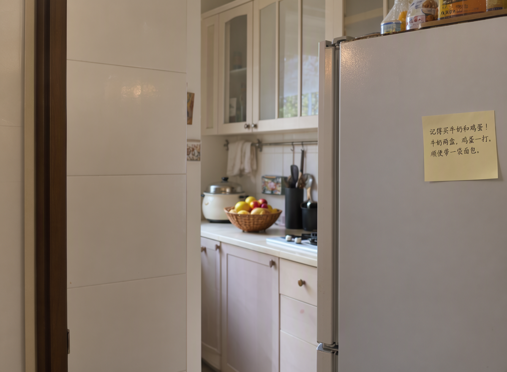

# Gallery: MOSS-Image-SFT

The Base gallery's five prompts and seeds, made by this recipe's `CHECKPOINT=sft python3 -m mac generate` on one M5
Ultra from checkpoint OpenMOSS-Team/MOSS-Image-SFT revision f972bd4b, on the pinned engine bd10bd9b, at the card's
defaults (50 steps, guidance 3, the empty negative prompt skipping block 22). Nothing was picked or retouched: each is
the one picture its prompt and seed gave. The same prompts with the Base weights are in the
[Base gallery](../../gallery/README.md).

| picture | size | seed |
|---|---|---|
| [1-bookshop.png](1-bookshop.png) | 1024 x 1024 | 42 |
| [2-portrait.png](2-portrait.png) | 1024 x 1024 | 7 |
| [3-sign.png](3-sign.png) | 1024 x 1024 | 42 |
| [4-fridge-zh.png](4-fridge-zh.png) | 1200 x 880 | 7 |
| [5-valley.png](5-valley.png) | 1344 x 768 | 3 |

## Prompts

1. A cozy bookshop interior on a rainy evening, warm lamplight, a cat sleeping on a stack of old books, rain streaking
   the window
2. Close-up portrait of an elderly fisherman with a weathered face and a knitted wool cap, soft overcast light, shallow
   depth of field, photograph
3. A vintage enamel shop sign that reads "OPEN 24 HOURS" in bold red letters, mounted on a brick wall
4. The model card's prompt, [cases/fridge-zh.txt](../../../cases/fridge-zh.txt)
5. A wide mountain valley at sunrise, mist over a winding river, pine forests, dramatic clouds, landscape photograph

